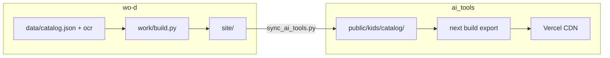

# 英语晨读目录（/kids/catalog）

## 在站点中的位置

- **首页入口**：`/kids` →「阅读目录」→ `/kids/catalog`（勿在 Vercel 上强制加尾斜杠，会与平台规则形成重定向环。封面相对路径靠页面内 `<base href="/kids/catalog/">` 解析。）
- **静态文件**：`public/kids/catalog/`（由 `wo-d` 仓库同步，勿手改）
- **注册表**：`lib/tools/kids-registry.ts` 中 `english-catalog`，`format: "library"`，`component: "static-site"`（不生成 `/kids/english-catalog` 的 Next 页面，避免与静态目录冲突）

## 发布前

```bash
npm run sync:catalog
npm run build
```

## 架构示意


